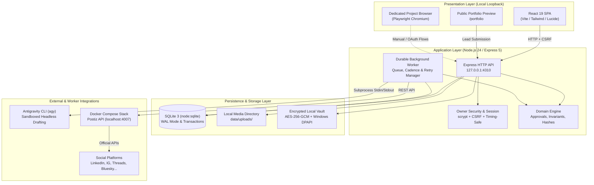

# ClientForge

The next-stage account and acquisition features are implemented locally. See [the implementation and verification record](docs/next-stage-implementation.md) for exact capabilities and remaining production blockers. New features include independent native account slots, multiple encrypted Postiz workspaces, campaign account assignments, opportunity imports, editable Antigravity proposal drafts and follow-up reminders at `/acquisition`.

Run `npm run start:public` for the separate portfolio server at **http://localhost:3001**. It exposes service pages and inquiry capture without administration routes. The dashboard stays loopback-only on port 3000. Docker/HTTPS configurations in `deployment/` are preparation only; no public deployment or authenticated social publication has been performed. Campaign recurrence preferences and heuristic opportunity scores have the limits described in the implementation record.

The dedicated FreelanceGrowth Browser and connection manager are now available at [http://localhost:3000/connections](http://localhost:3000/connections). Use the **FreelanceGrowth Browser** desktop shortcut. See [the browser and account connection guide](docs/browser-connections.md) for verified features, profile location, credentials setup and the remaining phases.

[](https://www.typescriptlang.org/)
[](https://react.dev/)
[](https://expressjs.com/)
[](https://nodejs.org/)
[](https://sqlite.org/)
[](https://github.com/gitroomhq/postiz-app)
[]()

> **The local-first freelance acquisition engine and factual content studio.**  
> Showcase verified work, generate grounded social content with Antigravity CLI, schedule multi-channel posts through Postiz, track client leads through a pipeline CRM, and maintain full data privacy on your own machine.

---

## Table of Contents

- [Overview & Philosophy](#overview--philosophy)
- [Key Features](#key-features)
- [Architecture & System Design](#architecture--system-design)
- [Service Verticals](#service-verticals)
- [Connectors & Platform Matrix](#connectors--platform-matrix)
- [System Requirements](#system-requirements)
- [Getting Started](#getting-started)
- [Postiz Integration & Social Scheduling](#postiz-integration--social-scheduling)
- [Operating the Studio](#operating-the-studio)
- [Security & Sandboxing](#security--sandboxing)
- [Data Storage, Backup & Disaster Recovery](#data-storage-backup--disaster-recovery)
- [Development, Testing & Project Structure](#development-testing--project-structure)
- [Attribution & Reused Software](#attribution--reused-software)

---

## Overview & Philosophy

ClientForge is purpose-built for independent freelancers, solo developers, and studio founders aiming to build a durable pipeline of international clients. Rather than relying on spammy direct messages, low-margin bidding wars, or fabricated social proof, ClientForge operates on a **truth-in-advertising** foundation:

1. **Grounded in Fact**: Content drafts are synthesized strictly from structured project evidence (problems solved, deliverables, client permissions, and measurable outcomes). No fabricated testimonials, false revenue metrics, or fake clients.
2. **Strict Verification**: Demo and personal projects are explicitly labelled as demos. Client confidentiality is guarded by rigorous showcase permission toggles.
3. **Local Sovereignty**: Runs 100% locally on loopback (`127.0.0.1`). SQLite with Write-Ahead Logging (WAL), Windows DPAPI-encrypted credential vaults, and sandboxed AI execution ensure that private business data and credentials never leave your control.
4. **Separation of Concerns**: AI drafts the content; the human approves the immutable version hash; the application manages scheduling and publishing.

---

## Key Features

- **Project Evidence & Asset Vault**: Store client case studies, problem-solution narratives, deliverables, metrics, and media files (PNG, JPEG, WebP, MP4 up to 50 MB).
- **Sandboxed Antigravity AI Drafting**: Uses the Google Antigravity CLI (`agy`) with strict session-scoped sandbox policies (`deny: command, read_file, write_file, mcp, url`) and Zod schema-enforced structured JSON output.
- **Multi-Platform Publishing via Postiz**: Connects to an isolated self-hosted Postiz container stack to publish across LinkedIn, Facebook Pages, Instagram, Threads, Bluesky, Mastodon, and Telegram.
- **Immutable Approval Engine**: Every post version is cryptographically fingerprinted (SHA-256). Any subsequent modification to content or source project evidence automatically invalidates existing approval.
- **Automated Content Cadence**: Define weekly scheduling rules by service and channel with IANA timezone calculations and daylight saving time (DST) safeguards.
- **Client Lead CRM & Attribution**: Track enquiries from initial touchpoint through to project closure (`New` &rarr; `Contacted` &rarr; `Qualified` &rarr; `Proposal` &rarr; `Won` &rarr; `Lost`) with full UTM parameter attribution.
- **Dedicated Project Browser**: Spawns an isolated Chromium profile via Playwright for manual platform verification, community engagement, and OAuth consent flows without polluting your daily browser.

---

## Architecture & System Design



---

## Service Verticals

ClientForge structures all projects, content generation, and client enquiries around four specialized service offerings:

| Vertical | Target Buyer | Typical Evidence | Call to Action |
| :--- | :--- | :--- | :--- |
| **Web Development & UI/UX** | Founders, agencies, small businesses | Live demos, screen recordings, design system comparisons, audits | *Request a project estimate* |
| **iOS & Android Apps** | Startups, product managers, founders | App walkthroughs, delivery scope, interactive prototypes | *Discuss an app idea* |
| **Excel & Data Analysis** | Operations, finance and analytics teams | Anonymized before/after spreadsheets, formula logic, dashboards | *Describe your spreadsheet problem* |
| **AI Video & ComfyUI** | Creators, agencies, creative studios | Video samples, ComfyUI workflow pipelines, setup blueprints | *Request a workflow consultation* |

---

## Connectors & Platform Matrix

ClientForge provides built-in definitions for 30+ platforms grouped into six functional categories:

| Platform | Category | Classification | Publishing Adapter | Status & Capabilities |
| :--- | :--- | :--- | :---: | :--- |
| **LinkedIn (Profile & Page)** | Social Media | Official API | Postiz | **Automatic** &middot; 3,000 chars &middot; Media optional |
| **Facebook Pages** | Social Media | Official API | Postiz | **Automatic** &middot; 5,000 chars &middot; Media optional |
| **Instagram & Standalone** | Social Media | Official API | Postiz | **Automatic** &middot; 2,200 chars &middot; **Media required** |
| **Threads** | Social Media | Official API | Postiz | **Automatic** &middot; 500 chars &middot; Media optional |
| **Bluesky** | Social Media | Official API | Postiz | **Automatic** &middot; 300 chars &middot; Media optional |
| **Mastodon** | Social Media | Official API | Postiz | **Automatic** &middot; 500 chars &middot; Instance rules apply |
| **Telegram** | Social Media | Official API | Postiz | **Automatic** &middot; 4,096 chars &middot; Media optional |
| **X (Twitter)** | Social Media | Official API | Postiz | **Manual Export** &middot; Adapter disabled by default |
| **YouTube** | Video & Social | OAuth Account | Native PKCE | **Channel Identity Only** (`youtube.readonly`) |
| **GitHub** | Developer Hub | OAuth Account | Native PKCE | **Identity Only** &middot; Public profile verification |
| **Marketplaces**<br/>*(Upwork, Fiverr, Freelancer, Contra, Toptal)* | Marketplaces | Browser-Assisted | Manual | **Manual Only** &middot; Dedicated browser profile for human proposals |
| **Communities**<br/>*(Reddit, Hacker News, Indie Hackers, Quora)* | Discussion | Browser-Assisted | Manual | **Manual Only** &middot; Human-reviewed participation; no auto-posting |
| **Publishing**<br/>*(Buffer, WordPress, Ghost, Substack)* | CMS & Marketing | API Key / Webhook | Buffer / Manual | Account validation & staging |

---

## System Requirements

- **Operating System**: Windows 10/11 (64-bit), macOS 13+, or Linux.
- **Node.js**: v24.11.0 or newer (required for built-in `node:sqlite` and cryptographic primitives).
- **Package Manager**: npm v10+ (dependencies locked in `package-lock.json`).
- **Docker Desktop**: Required to host the local Postiz publishing stack.
- **Google Antigravity CLI (`agy`)**: Installed and authenticated locally for headless AI generation.
- **Web Browser**: Google Chrome or Chromium (used by Playwright for the dedicated browser profile).

---

## Getting Started

### 1. Clone & Configure Environment

```powershell
# Clone the repository
git clone https://github.com/sukeshperiyasamy/clientforge.git
cd clientforge

# Create your local environment configuration
Copy-Item .env.example .env
```

Edit `.env` to set your desired port and configuration:

```ini
PORT=3000
DATA_DIR=data
AGY_PATH=agy
POSTIZ_URL=http://localhost:4007/api/public/v1
POSTIZ_API_KEY=
PUBLISHING_ENABLED=false
```

> [!IMPORTANT]
> Keep `PUBLISHING_ENABLED=false` until you have verified your accounts and reviewed your initial test posts.

### 2. Install Dependencies & Build Frontend

```powershell
# Install locked dependencies
npm ci

# Build the React production bundle
npm run build
```

### 3. Launch ClientForge

You can start the studio using the included PowerShell script (which automatically detects portable Node runtimes if present):

```powershell
./start.ps1
```

Or start directly with npm:

```powershell
# Production mode
npm start

# Development mode (with Vite HMR)
npm run dev
```

### 4. Open the Applications

- **Dashboard**: [http://localhost:3000](http://localhost:3000). Port 4310 remains a compatibility alias when the configured port is 3000.
- **Connections**: [http://localhost:3000/connections](http://localhost:3000/connections). Create your own local owner password on first use.
- **Public Portfolio Preview**: [http://127.0.0.1:4310/portfolio](http://127.0.0.1:4310/portfolio)
- **Self-Hosted Postiz Console**: [http://localhost:4007](http://localhost:4007)

---

## Postiz Integration & Social Scheduling

Postiz runs as a self-contained Docker Compose stack, keeping third-party OAuth tokens and social credentials isolated from your main application.

### 1. Initialize Postiz Configuration

Generate the hardened `docker-compose.yaml` with cryptographically secure random secrets bound to loopback:

```powershell
node scripts/prepare-postiz.mjs
```

### 2. Manage the Postiz Stack

Use the included helper script to control Postiz containers:

```powershell
# Start Postiz containers
./postiz.ps1 start

# Check container health and status
./postiz.ps1 status

# View live application logs
./postiz.ps1 logs

# Stop containers (preserves database volumes)
./postiz.ps1 stop
```

> [!CAUTION]
> Never run `docker compose down -v` against the `clientforge-postiz` project, as this will permanently erase your Postiz database and connected social tokens.

### 3. Connect Channels

1. Open [http://localhost:4007](http://localhost:4007) in your browser.
2. Complete the initial admin registration (store these credentials securely).
3. Connect your social channels (LinkedIn, Instagram, Facebook Pages, etc.) within the Postiz UI.
4. Go to **Settings &rarr; API** in Postiz and generate a Public API Key.
5. Paste this key into your local `.env` file as `POSTIZ_API_KEY=your_key_here`.
6. Restart ClientForge, navigate to the **Channels** tab, and click **Sync from Postiz**.

---

## Operating the Studio

### The Acquisition Workflow

```
1. Add Project Evidence  -->  2. Generate Drafts  -->  3. Review & Edit  -->  4. Approve & Schedule  -->  5. Track Leads
   • Problem & Solution        • Multi-platform          • Enforce facts       • Cryptographic hash      • Pipeline stage
   • Deliverables & Metrics    • Antigravity CLI         • Adjust hooks        • Postiz auto-publish     • Value & currency
   • Showcase permission       • JSON schema             • CTA & UTM links     • Provider verification   • UTM campaign
```

### 1. Adding a Project
Navigate to **Projects** and define a case study. Clearly describe the client's problem, your technical solution, measurable results, and upload visual proof (screenshots, recordings). If working with confidential client data, ensure that details are anonymized and the **Showcase Permission** checkbox is accurately toggled.

### 2. Generating Content with Antigravity
Select an active project, choose target channels, and click **Generate Drafts**. The backend launches a headless Antigravity process in an empty, sandboxed workspace, feeding project reference data through standard input. The resulting draft includes hooks, body copy, hashtag recommendations, and calls to action.

### 3. Review, Approval & Invalidation
Every generated draft must be reviewed by the owner. When you click **Approve**, ClientForge computes a SHA-256 hash of the content:

$$\text{approvedHash} = \text{SHA256}(\text{title} + \text{content} + \text{assetIds})$$

If you or a background process subsequently edits any text or asset, the approval is immediately revoked (`status = draft`), preventing unverified changes from reaching scheduled publication.

### 4. Content Cadence & Recurring Automation
Under **Cadence**, establish weekly publishing rules (e.g., *Post a Web Case Study to LinkedIn every Tuesday at 10:00 AM*). The background worker:
- Respects recipient IANA time zones.
- Adjusts for daylight saving transitions.
- Deduplicates jobs across server restarts.
- Skips jobs that are more than 24 hours overdue.

### 5. Managing Leads
Prospective clients who submit enquiries via `/portfolio` or direct UTM links appear in the **Leads** CRM. Update stages from `New` through `Won`, attach next-action notes, and track revenue closed by service vertical and acquisition campaign.

---

## Security & Sandboxing

ClientForge adheres to a defense-in-depth security model:

### 1. Network Boundary
- The Express server strictly binds to `127.0.0.1`. It does not accept remote network traffic.
- Postiz web port `4007` binds to `127.0.0.1`; its database and Redis ports are not published to the host.

### 2. Antigravity Sandbox Policy
The Antigravity CLI process is restricted using explicit session permissions:
```json
{
  "permissions": {
    "deny": [
      "command(*)",
      "read_file(*)",
      "write_file(*)",
      "read_url(*)",
      "execute_url(*)",
      "mcp(*)"
    ],
    "allow": [],
    "ask": []
  }
}
```
All project and profile inputs are treated as untrusted text strings inside the prompt, and publishing credentials (`POSTIZ_API_KEY`, OAuth tokens) are scrubbed from the subprocess environment.

### 3. Local Credential Vault
- **Windows**: Keys are encrypted using the Windows Data Protection API (DPAPI). .NET access-control APIs grant access only to the current user SID and SYSTEM; no execution policy changes or elevation are required.
- **At Rest**: Individual tokens are encrypted with `AES-256-GCM` using authenticated additional data (AAD).

### 4. Owner Authentication & CSRF Protection
- Password hashing uses `scrypt` ($N=32768, r=8, p=1$) with a unique 16-byte cryptographic salt.
- Verifications use `crypto.timingSafeEqual` to thwart timing attacks.
- Brute-force protection locks logins after 5 failed attempts per 15-minute window.
- State-changing API endpoints require both an `HttpOnly` cookie and a matching `x-csrf-token` header.

---

## Data Storage, Backup & Disaster Recovery

Application records live in ignored `data/`. The dedicated browser profile, downloads, screenshots and broker logs live separately in the protected per-user `%LOCALAPPDATA%/FreelanceGrowth/Browser/<project-id>/` directory. No personal Chrome profile is imported.

```text
data/
├── clientforge.sqlite         # Primary transactional database
├── clientforge.sqlite-wal     # Write-Ahead Log
├── clientforge.sqlite-shm     # Shared memory index
├── uploads/                   # Media attachments (PNG, JPEG, WebP, MP4)
├── security/                  # Legacy key location; migrated to protected per-user AppData
├── postiz/                    # Docker Compose configuration and state
└── logs/                      # Server and worker logs
```

### Performing a Consistent Backup

Run the automated backup script to create an atomic SQLite snapshot and copy all referenced media files:

```powershell
node scripts/backup.mjs
```

This creates a timestamped snapshot in `data/backups/backup-YYYY-MM-DDTHH-mm-ss/`.

### Disaster Recovery Procedure

To restore from a backup:
1. Ensure ClientForge is stopped: `Stop-Process -Name node -ErrorAction SilentlyContinue`.
2. Move or archive the existing `data/clientforge.sqlite` and `data/uploads/`.
3. Copy `clientforge.sqlite` from the backup folder into `data/`.
4. Copy the backup `uploads/` folder into `data/uploads/`.
5. Remove any leftover `clientforge.sqlite-wal` or `clientforge.sqlite-shm` files to prevent state corruption.
6. Restart ClientForge with `./start.ps1`.

---

## Development, Testing & Project Structure

### Repository Layout

```text
clientforge/
├── .env.example             # Template for local environment variables
├── .gitignore               # Strict exclusion rules for data, logs, and secrets
├── index.html               # Frontend HTML root
├── launch-browser.ps1       # Script to launch dedicated project browser
├── package.json             # Scripts and production dependencies
├── postiz.ps1               # Docker Compose management wrapper
├── start.ps1                # Main application launcher
├── tsconfig.json            # Strict TypeScript configuration
├── vite.config.ts           # Vite bundler configuration
│
├── browser/                 # Browser configuration; runtime profile is in protected per-user AppData
├── docs/                    # Architecture diagrams and UI screenshots
│   └── dashboard.jpg        # Studio dashboard preview
│
├── scripts/                 # Operational and maintenance automation
│   ├── backup.mjs           # Atomic SQLite and media backup utility
│   ├── install-shortcut.ps1 # Desktop shortcut installer
│   ├── launch-browser.ts    # Browser launcher with health check
│   ├── prepare-postiz.mjs   # Hardened compose generator
│   └── register-startup.ps1 # Optional Windows startup task installer
│
├── server/                  # Backend Express and worker services
│   ├── antigravity.ts       # Headless CLI integration and sandboxing
│   ├── app.ts               # REST API routes and request validators
│   ├── config.ts            # Environment loader and secret sanitizer
│   ├── connection-routes.ts # Connector and OAuth endpoints
│   ├── connections.ts       # Platform connector business logic
│   ├── domain.ts            # State machines, hash computation, invariants
│   ├── index.ts             # Server entry point and HTTP listeners
│   ├── postiz.ts            # Postiz Public API client
│   ├── security.ts          # DPAPI vault, scrypt auth, and ACL protection
│   ├── store.ts             # Transactional SQLite repository
│   └── worker.ts            # Queue consumer, cadence rules, and retries
│
├── shared/                  # Universal models and contracts
│   ├── connectors.ts        # 30+ platform definitions and limitations
│   ├── model.ts             # Zod schemas for projects, posts, and leads
│   └── time.ts              # IANA timezone calculations and DST handling
│
├── src/                     # Frontend React application
│   ├── api.ts               # Typed client API client
│   ├── AuthGate.tsx         # Password protection and setup modal
│   ├── ConnectionsPage.tsx  # Multi-channel connector dashboard
│   ├── main.tsx             # Main application UI and workflow views
│   └── style.css            # Custom responsive design system
│
└── tests/                   # Automated test suite
    └── system.test.ts       # 480+ lines of end-to-end integration tests
```

### Running Tests

The test suite covers approval invalidation, duplicate prevention, revoked permission handling, restart recovery, timezone conversion, generation errors, and security constraints:

```powershell
# Run the integration test suite
npm test

# Run TypeScript static type checking
npm run check
```

---

## Attribution & Reused Software

- **[Postiz](https://github.com/gitroomhq/postiz-app)**: Open-source social media scheduling architecture ([AGPL-3.0 License](https://github.com/gitroomhq/postiz-app/blob/main/LICENSE.md)). ClientForge interfaces with Postiz via its official [Public REST API](https://docs.postiz.com/public-api/introduction) without modifying Postiz application binaries.
- **[Google Antigravity](https://antigravity.google/)**: AI drafting via the official [Antigravity CLI](https://antigravity.google/docs/cli/headless/).
- **[Playwright](https://playwright.dev/)**: Browser automation driving the isolated project browser profile.
- **[Lucide Icons](https://lucide.dev/)**: Clean, consistent icon set for the studio interface.

---

## License

This project configuration and custom studio source code are maintained as a private, single-owner freelance productivity suite. Consult third-party licenses (such as Postiz AGPL-3.0) for compliance regarding bundled or external service distributions.
